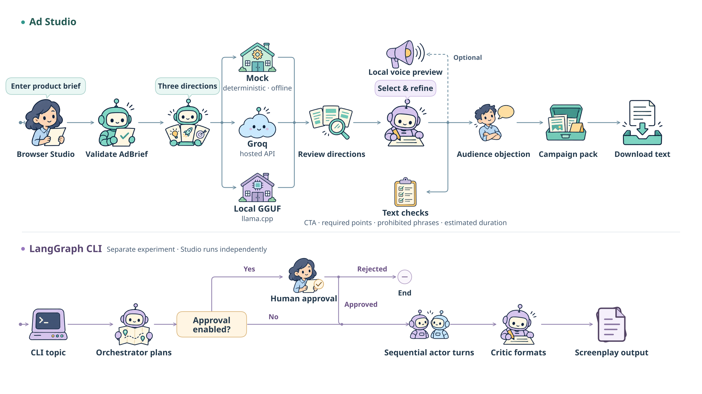
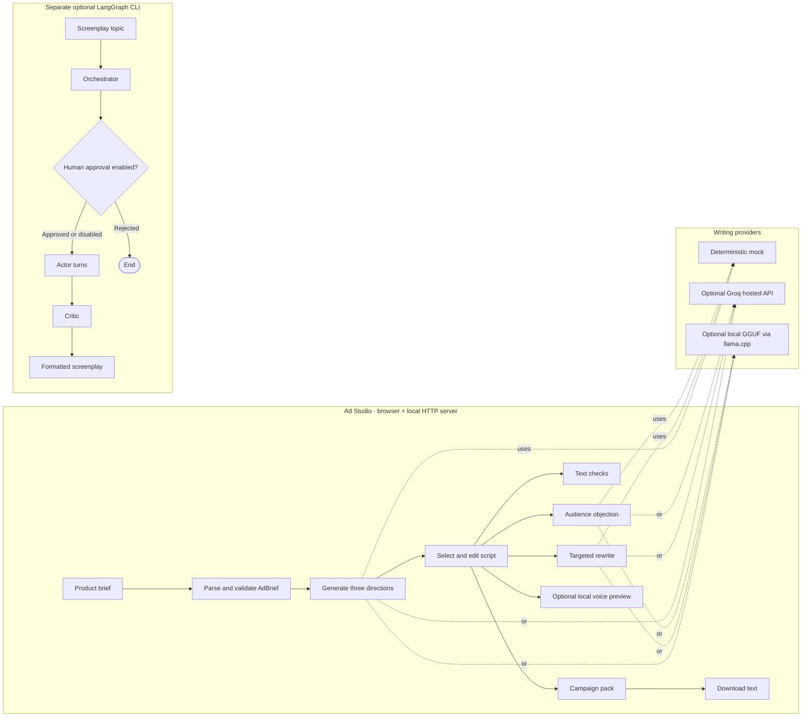

# Agentic Ad Scriptwriter



**An editorial workspace for turning a product brief into short-form ad concepts, scripts, and campaign-ready variations.**

The project combines a local-first browser studio with an optional LangGraph writers’ room. The studio helps a person compare three creative directions, refine a script, test it against an audience objection, and assemble a reviewable campaign pack. The default mock mode runs locally without an API key.

## What you can do

- **Start from a short brief.** Add the product, substantiated facts, audience, and main benefit. Script settings include tone, length, platform, call to action, and claims to avoid.
- **Compare three routes.** Review Clear, Playful, and Bold hooks side by side, then open a route in the script editor.
- **Refine with control.** Try focused rewrites, accept or undo each draft, and inspect checks for required details, prohibited claims, and estimated duration.
- **Pressure-test the copy.** Ask for one audience objection and decide whether to set it aside, answer it with a verified detail, or include the question in a draft.
- **Build a campaign pack.** Preview a main script, short cut, alternate hooks, and calls to action, then download the pack as text.
- **Choose a writing engine.** Use the deterministic offline demo, a hosted Groq model, or a local GGUF model through `llama.cpp`.

The checks are text-based guardrails. They do not verify factual truth, provide legal review, or predict ad performance.

## Try the offline Studio

Requirements: Python 3.13+ and [uv](https://docs.astral.sh/uv/).

```bash
uv sync --extra test
uv run python -m src.studio
```

Open <http://127.0.0.1:8765>. The server binds to localhost. Mock generation, the local artwork, and the built-in campaign tools make no model-provider requests. Stop the server with `Ctrl+C`.

To load the example brief, choose **Load example brief**. It fills the form with Northstar Coffee so you can inspect or edit the values before generating.

## Optional writing engines

### Groq hosted models

Install the workflow extra and set your key in the shell environment. Do not commit a real `.env` file or paste a key into source code.

```bash
uv sync --extra workflow
export GROQ_API_KEY="your-key"
uv run python -m src.studio
```

Choose **Groq · hosted** in the Studio. Hosted generation sends the brief and copy to Groq. The Studio uses `GROQ_MODEL` when set; otherwise it uses the model configured in `src/model_config.py`. Read [Privacy and data handling](docs/PRIVACY.md) before using hosted generation.

### Local GGUF model

Install the optional runtime and point the app at a model file already on your computer:

```bash
uv sync --extra local-model
export LLAMA_CPP_MODEL_PATH="/absolute/path/to/model.gguf"
uv run python -m src.studio
```

The application does not download model weights. `llama-cpp-python` may require platform-specific build tools. Runtime speed and context capacity depend on the selected model and hardware.

### Local voice preview

Voice output is optional and uses the operating system’s installed speech engine. On Fedora, install eSpeak NG, then install the project extra:

```bash
sudo dnf install espeak-ng
uv sync --extra voice
uv run python -m src.studio
```

Voice availability depends on the host system. A single selected system voice reads the script; separate character voices are not implemented.

## Optional LangGraph writers’ room

The CLI workflow is a separate experimental screenplay workflow. It is not the engine behind the Studio’s ad-writing flow.

```bash
uv sync --extra workflow
export GROQ_API_KEY="your-key"
uv run python -m src.main --topic "Two neighbors negotiate over a shared garden"
```

Add `--approve-plan` to pause for human review of the generated plan before actor turns begin. The graph streams plan, dialogue, and final-script updates. Its current in-memory checkpointer is process-local; an approval run cannot be recovered after the process exits.

## Architecture



The diagram shows implemented paths. The mock provider composes deterministic copy locally; hosted and local model providers are optional. Voice preview is also optional. The LangGraph CLI is a separate screenplay workflow, not part of the ad-writing Studio.

The Studio’s `AdBrief` domain object owns brief parsing and validation. The HTTP handler adapts browser requests to domain operations; provider adapters isolate mock, hosted, and local text generation. The separate LangGraph harness owns its own plan, actor loop, interrupt handling, and critic. See [Architecture and domain model](docs/ARCHITECTURE.md).

## Development and tests

```bash
uv sync --extra test
uv run pytest
```

Tests cover brief validation, Studio workflows, provider request construction, actor logic, plan validation, and compiled-graph approval and resume paths. Hosted-provider tests use mocked HTTP responses; run a live Groq workflow separately when provider behavior needs checking.

## Project status

This is a portfolio project in active development. The browser Studio’s offline path is usable; hosted and local model paths depend on external credentials or local runtime setup. The LangGraph CLI remains a separate experimental screenplay harness. Current limitations and next candidates are documented in the [roadmap](docs/ROADMAP.md).

## Portfolio summary

> Built a local-first ad-writing studio with a validated brief domain, three-way creative comparison, reviewable script rewrites, copy guardrails, and campaign-pack export. Added an optional LangGraph writers’ room with streamed updates and human approval/resume, backed by focused integration tests.

## Repository guide

- [Architecture and domain model](docs/ARCHITECTURE.md)
- [Privacy and data handling](docs/PRIVACY.md)
- [Roadmap and current limitations](docs/ROADMAP.md)
- [GitHub repository README guidance](https://docs.github.com/en/repositories/managing-your-repositorys-settings-and-features/customizing-your-repository/about-readmes)

**License:** No license file is currently included. Public visibility does not itself grant permission to reuse or redistribute this project. Choose a license before inviting community contributions.
