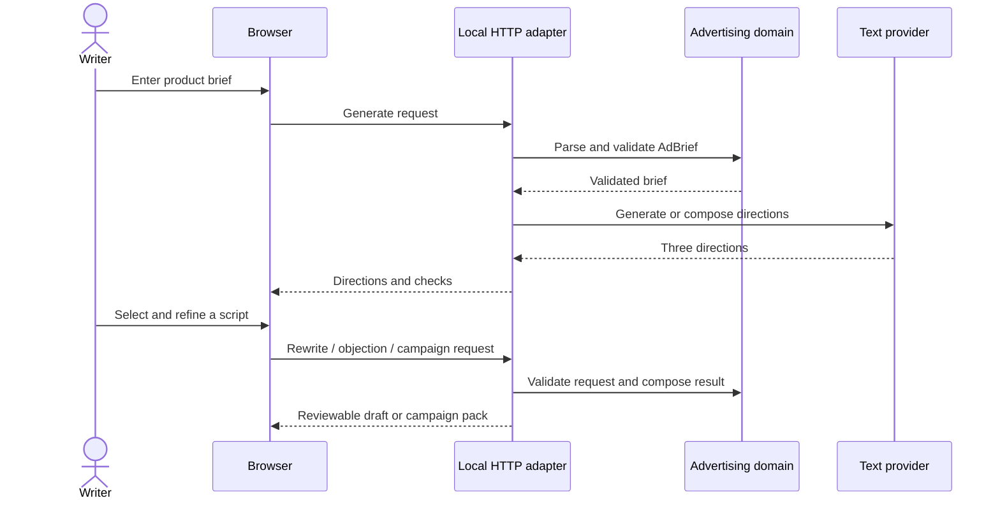
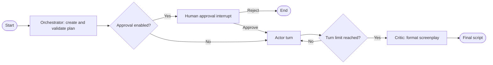

# Architecture and domain model

## Product boundary

The repository contains two related but separate workflows:

1. **Ad Studio** is the browser product for writing short advertisements.
2. **LangGraph CLI** is an experimental screenplay writers’ room retained from the original project.

The CLI does not currently power the Studio. Keeping that distinction explicit avoids implying that the screenplay graph generates Studio ad campaigns.

## Ad Studio flow

## Domain concepts

- **AdBrief**: the product facts, audience, benefit, creative settings, required points, and prohibited claims. Its parser validates required text, duration, and list inputs.
- **CreativeDirection**: a named route with a concept, hook, and full script. The Studio compares three routes.
- **ScriptDraft**: editable copy with explicit accept/undo behavior in the browser.
- **CampaignPack**: a selected main script plus optional cutdown, alternate hooks, alternate calls to action, and textual checks.
- **WritingProvider**: an adapter for offline mock generation, Groq hosted generation, or local `llama.cpp` generation.

The current code models `AdBrief` as a validated dataclass. Direction, draft, and campaign-pack data are currently represented as dictionaries at the HTTP and browser interfaces; stronger domain types are a future refactor candidate.

## LangGraph workflow

The compiled graph streams typed `custom` and `updates` events in LangGraph v2 format. The harness observes interrupt updates and resumes the same thread with `Command(resume=...)`. Plan validation runs before the graph accepts the generated plan. The graph currently uses `InMemorySaver`; checkpoints are lost when the process exits.

## Key implementation seams

- `src/advertising/brief.py` owns the brief’s domain fields and validation.
- `src/studio.py` contains the local HTTP adapter, provider adapters, and use-case functions.
- `src/studio.js` owns browser interaction and draft state.
- `src/studio.css` owns the visual system and responsive layout.
- `src/agents/` contains LangGraph planning, actor, and critic nodes.
- `src/harness.py` owns CLI streaming and human approval/resume.

The Studio uses only the Python standard library for offline operation. Optional provider libraries are installed through project extras.
